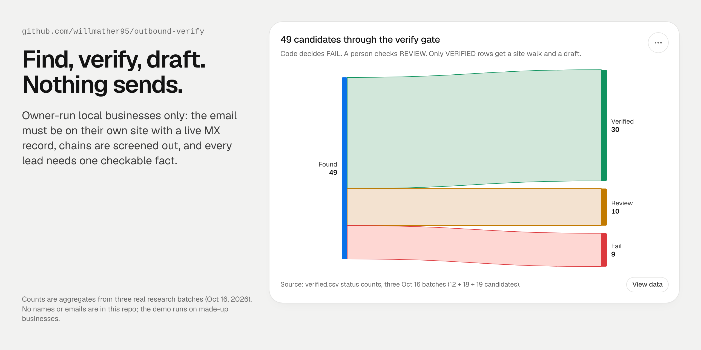

# outbound-verify



Cold outbound for local service businesses, built so agents can do the research and a person makes every send decision. Agents **find** owner-run businesses, code **verifies** each lead, agents **draft** one email around a checkable fact, and **nothing sends** without the owner's yes.

## What it does

| Stage | Who | What has to be true |
|---|---|---|
| **Find** | research agent | Owner-run business that markets the target service. The email is printed on their own site, and the agent records the page. |
| **Verify** | `verify.py` (code) | The email is seen on their site, the domain has a live MX record, and the name or pages don't match a chain block list. Group language ("a proud member of the … family") or a missing service proof sends the lead to REVIEW. TLS certificate checks are on, so a bad cert also goes to REVIEW instead of a silent pass. |
| **Site walk** | agent | One checkable fact with its exact URL. A blank fact means no email. |
| **Teardown** (optional) | headless Chrome + code | Passive capture of forms, booking vendor, call tracking and tag IDs. It never types, submits, books or clicks ads. |
| **Draft** | drafter + reviewer agents | Email 1: name, one dated fact, why it matters, one easy yes, opt-out and address. A reviewer in a fresh context plays the skeptical owner. Code checks length, links and banned words. |
| **Send** | the owner | Drafts only. Sending needs an explicit yes. |

## How it works

```
find.csv ──► verify.py ──► VERIFIED ──► site walk ──► 1 fact + URL ──► draft ──► reviewer ──► owner yes
   name,city,url,email   ├─► REVIEW  ──► person checks About/Terms ─┘
                         └─► FAIL    ──► dropped (no MX, email not on site, chain)
```

- **The rules live in config, not code.** Edit [`dso-config.json`](skills/prospect-find-verify/scripts/dso-config.json) to change the chain block list, group-language patterns, service-proof patterns or the pages to read.
- **Code decides FAIL. A person decides REVIEW.** Models never overrule the block list. In the teardown, the code vendor table overrides the labeling model, and every disagreement is logged.
- **No lead data in the skills.** Names, emails and facts stay in each batch folder, and verify reruns within 7 days of any send.

## Results

| | |
|---|---|
| Candidates through the gate | **49** (three research batches, Oct 16, 2026: 12 + 18 + 19) |
| VERIFIED | **30** |
| REVIEW (a person checks) | **10** |
| FAIL (dropped by code) | **9** |

Honest note: my first small test sends in October 2026 got no replies. So this repo shows the research and verification system, not a reply rate. No real names, emails or businesses are in it. The demo and tests use made-up businesses on `.example` domains.

## Run it

```bash
python3 -m unittest discover tests      # offline: 6 made-up leads → 1 VERIFIED, 2 REVIEW, 3 FAIL

python3 skills/prospect-find-verify/scripts/verify.py \
  examples/sample-find.csv verified.csv skills/prospect-find-verify/scripts/dso-config.json
# live run: fetches each site + a DNS-over-HTTPS MX lookup
```

The made-up sample leads won't resolve live, so they FAIL. That's the expected result. Use your own `find.csv` (no header: `name,city_state,url,email,page_where_email_seen`).

Teardown scripts (`skills/prospect-find-verify/scripts/teardown/`) need Node 22, Chrome, and `pip install beautifulsoup4`.

## Layout

```
skills/prospect-find-verify/   SKILL.md, verify.py, dso-config.json, teardown/ (capture, parse, GTM tags)
skills/situation-cold-email/   SKILL.md: situation → email 1 + math follow-up, drafter/reviewer loop
examples/sample-find.csv       made-up leads
tests/                         offline test with fixture pages and MX answers
```

MIT license. The drafter-reviewer loop adapts an idea from [MadsLorentzen/ai-job-search](https://github.com/MadsLorentzen/ai-job-search) (MIT).
